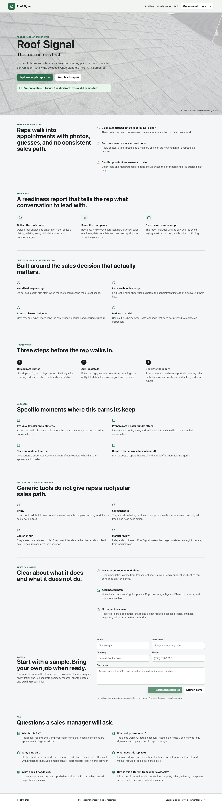
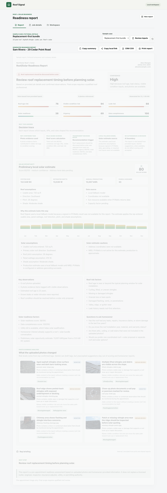
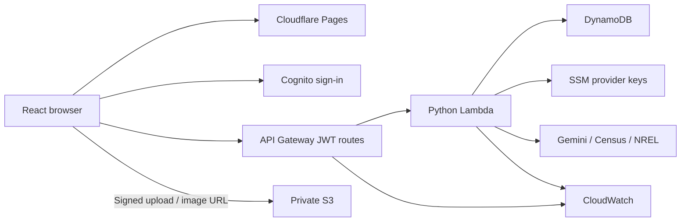

# Roof Signal

**An AWS/cloud engineering work sample built around a roof + solar readiness workflow.**

Roof Signal turns roof photos, rep-confirmed observations, and property details into an explainable pre-appointment report. A React/TypeScript frontend runs on Cloudflare Pages; an optional Terraform-managed AWS backend provides invite-only Cognito accounts, company-scoped DynamoDB records, private S3 photos, expiring homeowner links, and server-side Gemini/NREL integrations. The public demo needs no AWS account. This repository demonstrates implementation and operational decisions; it does not claim production adoption, licensed inspection, or final solar design.

[Live sample report](https://roofsignal-readiness-agent.pages.dev/app?demo=replacement-first#report) · [Reviewer guide](docs/reviewer-guide.md) · [Architecture](docs/architecture.md) · [Runbook](docs/runbook.md)

<details>
<summary>Local UI screenshots</summary>

Actual local captures with fictional sample details. These show the working tree, not a confirmed live release.




</details>

## Problem, Solution, Value

Roof timing can change the scope of a solar appointment. Scattered photos and notes make that decision hard to explain consistently. Roof Signal provides structured intake, visible scoring rules, AI drafts that require human confirmation, and a report separating homeowner guidance from internal sales notes. Its operational value is a repeatable handoff before quoting; no conversion or revenue uplift has been measured.

## Stack And Engineering Highlights

- **Frontend:** React, TypeScript, Vite, plain CSS, Lucide icons, Vitest; report/job/workspace views, local history, branded print and CSV exports.
- **Cloud:** API Gateway HTTP API, Python 3.12 Lambda, Cognito, DynamoDB on-demand, private S3, SSM SecureString, CloudWatch, Terraform.
- **Boundaries:** company-keyed records/photo prefixes, server-assigned account attributes, owner/admin mutations, allowlisted share responses, bounded signed uploads.
- **Operations:** validation-only GitHub Actions, retained request/access logs, Lambda alarms, throttling, provider quotas, concurrency limits, explicit rollback and cleanup procedures.
- **Tradeoffs:** one Lambda and one Terraform root keep the sample inspectable. Cloudflare delivers the frontend; AWS owns hosted data. [Decisions](docs/tradeoffs.md).

## Architecture



[Container diagram, runtime, auth and data flows](docs/architecture.md). Local mode uses browser storage and solar assumptions; AWS mode requires separate provisioning. The live demo is not evidence that the AWS stack or local changes are deployed.

## Evidence Matrix

| Area          | Evidence                                                                                                                                              |
| ------------- | ----------------------------------------------------------------------------------------------------------------------------------------------------- |
| IaC           | [Terraform root](infra/aws/main.tf), provider lock, fmt/init/validate in CI; manual plan/apply, no modules or automated plan approval                 |
| CI/CD         | [Validation workflow](.github/workflows/validate.yml): frontend tests/typechecked build, backend tests, Terraform checks; AWS delivery is manual      |
| Security      | [Threat model](docs/security.md): resource-scoped IAM, JWT, tenant/owner checks, SSM, private uploads, share projection; limitations explicit         |
| Reliability   | Provider fallbacks/timeouts, logical expiry, safe record deletion, [rollback/recovery runbook](docs/runbook.md); no failover claim                    |
| Observability | [Retained logs and error/throttle alarms](docs/observability.md); notification routing, traces and dashboards remain gaps                             |
| Cost          | On-demand storage, quotas, concurrency, retention and [cost drivers](docs/cost-model.md); no invented bill or savings                                 |
| Operations    | [Deployment](docs/deployment.md), [troubleshooting](docs/runbook.md), [teardown](docs/teardown.md)                                                    |
| Testing       | [Domain tests](src/lib/roofReadiness.test.ts), [backend tests](backend/tests), [coverage boundaries](docs/testing.md); no cloud integration/e2e claim |
| Documentation | [Reviewer guide](docs/reviewer-guide.md), [architecture](docs/architecture.md), [five ADRs](docs/adrs/README.md)                                      |

## Local Quickstart

Node.js 22.12+ and npm. No cloud credentials or provider keys are needed.

```bash
npm ci
npm run dev
```

Open `http://localhost:5173`: landing at `/`, labeled sample at `/app`, empty job at `/app?blank=1`. Use `npm run dev -- --port 5174` if needed. Demo reports/settings live in this browser; uploaded image bytes are not persisted locally. Clear site data to remove local history.

## Validation

```bash
npm test
npm run typecheck
npm run build
python3 -m venv .venv
.venv/bin/pip install -r backend/requirements-dev.txt
.venv/bin/python -m unittest discover -s backend/tests -v
terraform -chdir=infra/aws fmt -check
terraform -chdir=infra/aws init -backend=false
terraform -chdir=infra/aws validate
git diff --check
```

Build output is `dist/`; `public/_redirects` enables SPA routes. No separate ESLint configuration, Checkov/TFLint scan, or Docker runtime. [Testing and smoke procedure](docs/testing.md).

## Deployment And Configuration

Cloudflare Pages: Vite preset, `npm run build`, output `dist`, production branch `main`. Inspect the Cloudflare project to confirm its current Git integration; source code alone cannot prove automatic deployment settings.

AWS: init, review a plan, apply, inspect outputs and create the first Cognito invitation. The [deployment guide](docs/deployment.md) preserves the setup steps, admin-create-user command, state protection, environment mapping and smoke checks. Never commit environment secrets, Terraform state/plans, provider keys or the Lambda archive.

Use [.env.example](.env.example) for configuration names:

- `VITE_AWS_API_URL`, `VITE_AWS_REGION`, `VITE_AWS_USER_POOL_CLIENT_ID`, `VITE_AWS_COGNITO_DOMAIN` enable hosted mode. `VITE_AWS_USER_POOL_ID` is also exported for operator reference.
- Hosted Gemini/NREL keys are server-side SSM parameters. Terraform state contains their values despite `sensitive = true`; protect state.
- `VITE_NREL_API_KEY` is browser-visible and suitable only for local experiments. Census matching is U.S.-only; missing provider data falls back to stated assumptions.
- Demo Gemini is off by default. A server key plus `ENABLE_DEMO_GEMINI=true` enables a same-origin development endpoint; it is unauthenticated and unsuitable as a production abuse boundary. Prefer authenticated AWS mode. Selected images go to Google; only accepted/edited evidence affects scoring.

## Operating Model

**Security:** invite-only accounts, JWT, tenant/owner checks, private photos, short-lived URLs and homeowner share redaction. Implicit OAuth/browser token storage remain risks. [Security model](docs/security.md).

**Observability:** CloudWatch access/request metadata, retained Lambda logs and alarms. Notification routing is required for unattended use. Client provenance is explanatory data, not an immutable audit ledger. [Observability model](docs/observability.md).

**Cost:** no always-on application servers or NAT. On-demand DynamoDB, concurrency limits, API throttles, daily provider quotas, report/share TTLs and S3 lifecycle constrain some usage; they are not a billing cap. [Cost model](docs/cost-model.md).

**Cleanup:** deleting a report closes its share links; photos remain until independent lifecycle cleanup because reports can reuse them. Already issued image URLs can work until expiry. Full teardown requires reviewed data disposal, emptying the non-force-destroy photo bucket, then Terraform destroy. Cloudflare and browser data are separate. [Teardown](docs/teardown.md).

## Limitations And Next Improvements

No licensed inspection, automatic roof measurement, structural determination, insurance decision, engineering/permitting review, or final panel layout. Roof area/shading are assumptions. No paid users, accuracy benchmark, SLA, recovery exercise, billing or direct CRM integration is claimed.

Next: authorization code + PKCE, stronger session handling, server-authored audit events and score validation, AWS integration tests and solar parity fixtures, report pagination, secure remote state, backups/recovery drills, alarm recipients and budget alerts. Existing demo photo provenance/licensing needs a record before broader redistribution. [Review gaps](docs/reviewer-guide.md).

## Project Structure

| Path                            | Responsibility                                                |
| ------------------------------- | ------------------------------------------------------------- |
| `src/App.tsx`, `src/styles.css` | Landing, job/report/workspace and print presentation          |
| `src/lib/`                      | Scoring, estimates, storage, AWS/provider clients and tests   |
| `backend/lambda/app.py`         | Hosted authorization, persistence, uploads and provider calls |
| `backend/tests/`                | Mocked boundary tests, excluded from Lambda archive           |
| `functions/`                    | Optional local/Cloudflare demo evidence endpoint              |
| `infra/aws/`                    | Terraform-managed AWS stack                                   |
| `.github/workflows/`            | Credential-free validation                                    |
| `docs/`                         | Architecture, decisions, operations and review evidence       |
