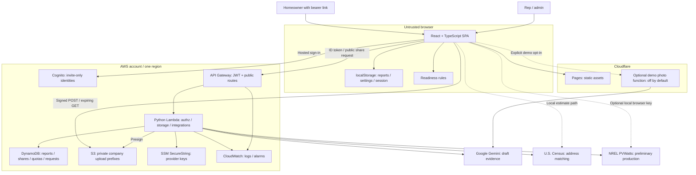

# Architecture

Roof Signal has two modes: a browser demo and an optional company-scoped AWS workspace. The SPA owns intake, rule-based readiness scoring and presentation. Hosted mode adds accounts, photo/report storage, sharing and provider boundaries; it does not make the rules a licensed inspection.

## Containers And Trust Boundaries

## Runtime And Data Flow

1. A rep supplies photos, job details and solar assumptions. Confirmed tags become scoring inputs; AI drafts are excluded until accepted/edited.
2. The browser calculates readiness in [roofReadiness.ts](../src/lib/roofReadiness.ts). [solarOpportunity.ts](../src/lib/solarOpportunity.ts) uses Census/PVWatts when available, otherwise explicit assumptions. Hosted provider calls run through Lambda.
3. Local JSON persistence excludes uploaded image bytes. Hosted uploads receive a signed S3 POST policy; the browser uploads directly to a company prefix.
4. Lambda validates authorization/storage keys and stores report JSON in the company partition. Reads hydrate photos with short-lived URLs. Report TTL and photo lifecycle are separate.
5. Share creation stores an opaque bearer token and expiry. Public reads resolve company/report server-side and project approved homeowner fields. Shared UI is read-only; internal notes, sales guidance and browser audit events are excluded.

## Authentication And Authorization

Cognito invitations assign `custom:companyId` and `custom:role`. The SPA currently uses implicit OAuth and local token storage. API Gateway validates issuer/audience/expiry; Lambda uses trusted ID-token claims for company and owner/admin authorization. The web client cannot write tenant/role attributes. Mutable schema attributes permit administrator reassignment without pool replacement.

Company keys and photo prefixes are checked independently of JWT authentication. `/health`, `/request-access`, and `/share/{shareId}` are intentionally public. A share link grants its holder read access; it is not a verified homeowner identity.

## Deployment And CI

GitHub Actions validates npm tests/typechecked build, mocked backend tests and Terraform fmt/init/validate without AWS credentials. It neither plans against a live account nor deploys. Cloudflare project settings control frontend Git builds; an operator reviews and applies AWS plans separately. The Lambda archive includes only `app.py`.

The Terraform root defines resources directly, not reusable modules. State defaults to local storage; a protected remote backend is needed for shared ownership. See [deployment](deployment.md) and [ADRs](adrs/README.md).

## Constraints

- Managed AWS endpoints are internet-reachable. No VPC, private subnets or NAT are defined. JWT, app authorization and signed S3 policies enforce access; CORS is not authentication.
- One Lambda role can access all company records/uploads in this stack. Tenant separation is application-enforced, not separate IAM roles/accounts.
- Scoring and provenance are browser-authored; hosted storage does not make them authoritative or tamper-proof.
- Report JSON is bounded below DynamoDB's item limit. Listing is bounded, without full pagination.
- Photo URLs expire independently of shares. Reload to refresh. TTL/lifecycle deletion is asynchronous; logical report/share expiry is checked on reads.
- Single region; no queue, failover, transactional photo/report commit, tracing platform or measured availability target. [Failure handling](runbook.md).
